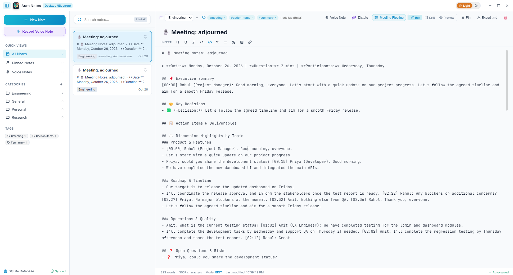

# Aura Notes — Modern Desktop Application

A modern desktop notes and knowledge application built with **Electron 34**, **React 19**, **Vite 6**, and **TypeScript**, featuring an advanced in-memory search engine and a glassmorphic dark-mode UI.



---

## ⚡ Quick Start

### 1. Development Mode
Runs Vite dev server with Hot Module Replacement (HMR) and launches the Electron desktop shell concurrently:
```bash
npm run dev
```

### 2. Production Build
Compiles TypeScript, bundles the React frontend via Vite, and bundles the Electron main & preload processes with esbuild:
```bash
npm run build
```

### 3. Run Production Electron Build
```bash
npm run dev:electron
```

---

## 🏗️ Architecture Overview

```
d:/Shrikant/practice/rea/
├── electron/
│   ├── main.ts              # Electron main process (Window lifecycle, IPC handlers, Local disk I/O)
│   └── preload.ts           # Sandboxed contextBridge API exposing `window.electronAPI`
├── src/
│   ├── components/
│   │   ├── TitleBar.tsx     # Desktop frame, system info, evidence launcher, window controls
│   │   ├── Sidebar.tsx      # Categories, tag filters, quick views (pinned/all), disk sync status
│   │   ├── SearchBar.tsx    # Query input with keyboard shortcuts (Ctrl+K), syntax chips, latency timing
│   │   ├── NoteList.tsx     # Filtered note cards with highlighted snippets and pin toggle
│   │   ├── NoteEditor.tsx   # Markdown editor & live preview, tag management, file export
│   │   ├── SearchEvidenceModal.tsx # Interactive search lexer and architectural walkthrough
│   │   └── SystemInfoModal.tsx     # Real-time desktop system diagnostics via IPC
│   ├── data/
│   │   └── initialNotes.ts  # Pre-loaded notes with tags and markdown content
│   ├── types/
│   │   ├── electron.d.ts    # TypeScript definitions for window.electronAPI
│   │   └── note.ts          # Note, SearchFilter, and SearchMatch interfaces
│   ├── utils/
│   │   └── searchEngine.ts  # Multi-stage token lexer, weighted scoring, and snippet extractor
│   ├── App.tsx              # Root application state, disk sync, and layout
│   ├── index.css            # Custom glassmorphic dark mode styling tokens
│   └── main.tsx             # React entry point
├── package.json
├── tsconfig.json
└── vite.config.ts
```

---

## 🔍 How Search Works in Notes Apps (Evidence & Mechanics)

Modern note-taking applications (Apple Notes, Obsidian, Bear, Notion) use a multi-stage search pipeline rather than simple substring matching:

### 1. Token Lexing & Operator Parsing
User queries are normalized and split into distinct search facets:
- **Free terms**: split by whitespace, case-folded.
- **Exact phrases**: extracted from double quotes (e.g., `"search mechanics"`).
- **Tag filters**: extracted via `tag:xyz` or `#xyz`.
- **Category filters**: extracted via `category:xyz` or `cat:xyz`.
- **Pin filter**: extracted via `is:pinned`.

*Implementation:* [`src/utils/searchEngine.ts`](file:///d:/Shrikant/practice/rea/src/utils/searchEngine.ts#L17-L55)

### 2. Weighted Relevance Scoring
Matches across different fields are ranked according to human reading priority:
| Match Location | Weight Points | Rationale |
|---|---|---|
| **Exact Title Match** | `+100` | Exact intent match |
| **Title Starts With** | `+60` | High prefix relevance |
| **Title Contains** | `+40` | Partial title relevance |
| **Tag Match** | `+35` | Intentional categorization |
| **Exact Quoted Phrase** | `+80 (Title) / +40 (Body)` | Explicit phrase preservation |
| **Content Body Match** | `+15` (+ up to `+25` TF) | Term frequency in body |
| **Pinned Note** | `+10` | User priority boost |
| **Recency (<7 days)** | `+0` to `+5` | Freshness decay bonus |

*Implementation:* [`src/utils/searchEngine.ts`](file:///d:/Shrikant/practice/rea/src/utils/searchEngine.ts#L112-L215)

### 3. Contextual Snippet Extraction
Instead of showing the first 100 characters of a note, the engine finds the first occurrence of any query token in the document body and extracts a focused window around it with ellipsis markers (`...match...`).

*Implementation:* [`src/utils/searchEngine.ts`](file:///d:/Shrikant/practice/rea/src/utils/searchEngine.ts#L80-L107)

### 4. Dynamic Highlight Rendering
Tokens are safely regex-escaped and wrapped with `<mark class="search-highlight">` tags, providing instant visual feedback in both the note title and body snippet.

*Implementation:* [`src/utils/searchEngine.ts`](file:///d:/Shrikant/practice/rea/src/utils/searchEngine.ts#L60-L75)

---

## 🖥️ Desktop Native Features

- **Persistent Disk Storage**: Notes are automatically saved to `app.getPath('userData')/aura_notes_store.json` via Electron IPC.
- **File Export**: Export individual notes as `.md` or `.txt` files directly using native OS save dialogs.
- **Keyboard Shortcuts**: Press `Ctrl+K` or `/` from anywhere to focus search.
- **Zero-Trust Security**: Electron runs with `contextIsolation: true`, `nodeIntegration: false`, and sandboxed `preload.ts`.
